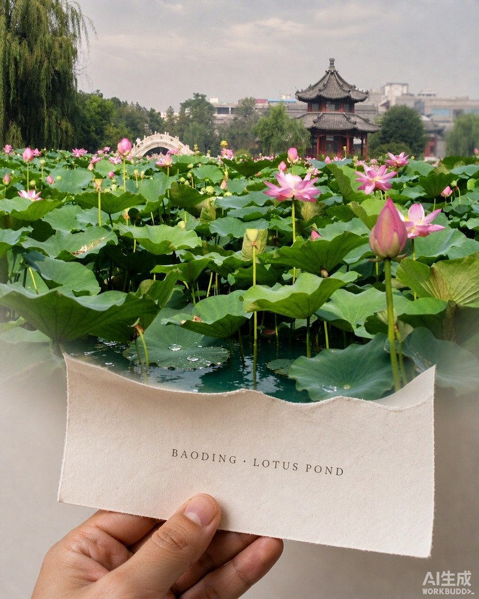

# 照片从卡片里长出来 · 技能包

> 上传一张旅行照，让照片自己变成一个真实的世界。
>
> 近处是一张被手捻住的纸，中段纸边融化，远端完全没有边界 —— 人物、建筑、树木、水面不是「印」在卡上，而是从纸里真正立起来。

| 你给它的 | 它还你的 |
|---|---|
|  |  |

---

## 一、这是什么

这不是一个「照片加相框」的效果，恰恰相反 —— **它要消灭相框**。

核心只有一句话：

> 不是「把照片放进卡片里」，而是「这张纸正在变成这个世界」。

一张 4:5 竖版成片里，从下到上必须是这样连续过渡的：

| 位置 | 状态 |
|---|---|
| 下段（近端） | 一只真实的手 + 柔软薄纸的近端，毛边、纸纤维清晰可见 |
| 中段 | 纸边开始变薄、变透明；主体从纸面隆起，有厚度、阴影、遮挡 |
| 上段（远端） | **完全没有纸边**，和背景共用同一个地平线、同一束光 |
| 最远 | 已经分不出纸在哪里结束 |

**唯一判据**：你能不能指出纸的远端边缘在哪？指得出来 = 失败。

---

## 二、安装（2 分钟）

### 1. 找到你的 AI 工具的 skills 目录

| 工具 | skills 目录 |
|---|---|
| WorkBuddy | `~/.workbuddy/skills/` |
| Claude Code | `~/.claude/skills/` |
| 其他支持 SKILL.md 的工具 | 各自文档里约定的 skills 目录 |

### 2. 把整个文件夹放进去

```bash
# macOS / Linux
cp -r 照片从卡片里长出来-技能分享 ~/.workbuddy/skills/travel-card-to-world

# Windows（PowerShell）
Copy-Item -Recurse "照片从卡片里长出来-技能分享" "$HOME\.workbuddy\skills\travel-card-to-world"
```

> 目录名建议就用 `travel-card-to-world`，和 SKILL.md 里的 `name` 保持一致，工具才认得出。

### 3. 装依赖（只有一个）

脚本只用 Pillow：

```bash
python -m pip install pillow
```

### 4. 确认工具支持图片生成

这个技能靠 AI 工具的**图生图**能力出片（要能接收一张参考图 + 提示词）。
WorkBuddy 用内置的 ImageGen；Claude Code 之类可以接自己的图片生成 MCP / API。

---

## 三、怎么用

装好之后，直接跟 AI 说：

> 用 travel-card-to-world 技能，把这张照片做成「照片从卡片里长出来」的效果

再附上照片就行。也可以说「照片从卡片里长出来」「卡片变成世界」，技能会被自动唤起。

AI 会自己走完这几步：判断照片类型 → 提炼主体 → 组装提示词 → 出图 → 按清单自检不合格就重出。

### 想自己调提示词

打开 `references/prompt-master.md`，里面是**三段分区版**完整提示词，8 个槽位：

| 槽位 | 填什么 |
|---|---|
| `{{ONE_LINER}}` | 一句话核心：照片正在从一张软纸变成真实的 XX |
| `{{TYPE_RULE}}` | 照片类型规则（风景 / 人物 / 人物+环境，三选一） |
| `{{BAND_TOP}}` | 顶 35% 里只能有什么（纯真实世界） |
| `{{BAND_MID}}` | 中段纸边怎么消失、什么开始立体 |
| `{{BAND_BOTTOM}}` | 底部 65–100% 只有手 + 纸近端 + 文字 |
| `{{SUBJECTS}}` | 2–5 个主体，带数量和相对位置 |
| `{{MEDIUM_LINK}}` | 纸靠什么介质长进背景（沙滩/水面/草地…） |
| `{{COLOR_RULE}}` | 色彩规定（**原图偏灰时必填**） |
| `{{CARD_TITLE}}` | 纸上的英文大写地名，≤3 词 |

里面有 5 套填好的示例（海边 / 城市 / 人物 / 园林 / 阴天荷塘），照着改最快。

---

## 四、三个最容易踩的坑

### 坑 1：模型死活要画宝丽来白边

这是最大的坑。加一堆「禁止相框」「禁止白边」基本没用，因为你要的是**同一类物体的反常规形态**，不是别的物体。

**真正管用的三招**（按效力排序）：

1. **换材质，不加禁止**。把「硬挺卡片」写成「柔软轻薄的印刷纸，被手指捻住，向画面上方弯曲，中部下弯，远端没有边」。相框画不出弯曲的软纸，物理上就排除了。
2. **给坐标，不给形容词**。「远端逐渐消失」是废话；「画面顶部 35% 这一段里不得出现任何纸边、白框、纸张转角」模型才会照做。
3. **末尾加自检句**。「如果画面上半部分能看到任何一条纸边，就是失败」——模型会自我复核。

### 坑 2：成片比原图还灰、还寡淡

手机直出、阴天、雾霾的照片，模型会**忠实继承那个灰度**。这时别指望它自己提亮，要逐项规定：

- 天空：「柔和通透的浅银灰带一点暖意，不是平坦的灰白板」
- 主体：「干净通透的翠绿与黄绿，有明确明暗分层和边缘高光，不是发脏的黄绿」
- 再加一句否定：「不要发灰、不要发黄、不要寡淡」
- 自检里写上：「如果成片比原图更灰更淡，也是失败」

### 坑 3：纸上主体像一张褪色的印刷图

光说「立体」不够，要给物理细节：

> 「纸面在荷叶根部产生真实的凹陷和阴影」「荷花比叶片高出 15–25cm，在后方叶片上投下真实阴影」

有了「根部凹陷」和「投下阴影」，模型才知道该怎么把东西鼓起来。

更多问题排查见 `references/diagnose.md` 里的**失败修法表**（12 种现象 → 根因 → 只改哪一句）。

---

## 五、文件说明

```
照片从卡片里长出来-技能分享/
├── README.md                        ← 你正在看的这份
├── SKILL.md                         ← 技能主文件（AI 读的流程）
├── references/
│   ├── prompt-master.md             ← 主用：三段分区版提示词 + 槽位 + 5 套示例
│   ├── prompt-master-article.md     ← 文章原版提示词（概念参考，别单独用）
│   ├── diagnose.md                  ← 类型判断、主体提炼、介质表、修法表、九条自检
│   └── examples.md                  ← 四案例拆解 + 单变量调参 + 一次真实调试记录
├── scripts/
│   └── imgtool.py                   ← 预处理 / 裁 4:5 / 拼对比图
└── 示例/
    ├── 示例-原图.jpg
    └── 示例-成片.jpg
```

### 小工具用法

```bash
# 预处理（统一 EXIF 方向、转 sRGB、限长边、输出干净 JPG，并打印尺寸/亮度/主色）
python scripts/imgtool.py prepare 你的照片.jpg --info

# 居中裁成 4:5
python scripts/imgtool.py crop 成片.png --ratio 4:5 --out 成片_45.jpg

# 多版结果拼成对比图
python scripts/imgtool.py sheet ./out --out 对比.jpg --height 700
```

---

## 六、几件值得知道的事

- **风景照和人物照要用两套规则**。风景锁「场景内容」，人物锁「人物身份」（脸不能变），别一套硬套。
- **忠实内容，不忠实构图**。上传的照片是内容依据，不是版式模板。原图里大片天空、水面、空地必须压缩删掉，否则主体会变小 —— 这条最反直觉，也最容易做错。
- **人物照要把参考强度调高**（`input_fidelity: high`），风景照反而要调低（`low`），因为风景需要重新构图。
- **尺寸**：`1024x1280` 就是标准 4:5，不用再裁。
- 出图会消耗 AI 服务的额度，一张大约几条到十几条不等。

---

## 七、来源与致谢

- **创意与原始提示词**：公众号「这事AI能做」2026-09-10《我只用了一条提示词，就让旅行照片从卡片里长出来》。原始十一节版提示词完整保存在 `references/prompt-master-article.md`，版权归原作者。
- **本技能包的增量**：把原版提示词改造成实测可用的三段分区版；补上「换材质破宝丽来先验」「百分比坐标」「自检句」「灰平调色彩规定」四组技法；新增照片类型判断、主体提炼、介质连续性表、失败修法表、九条自检；写了三个小工具脚本。
- 示例图由 AI 生成（原图摄于河北保定古莲花池）。

## 八、声明

生成的图片属于 AI 合成图像，公开发布时建议标注「AI 生成」。人物照请确保已获得照片中人物的授权。
